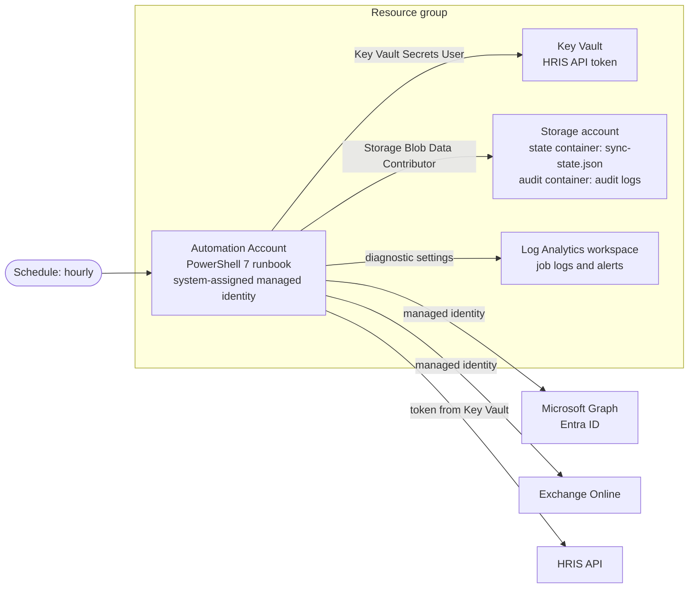

# Azure design

How the sync would run in Azure. The aim is a small number of managed services,
no stored secrets for Microsoft services, and enough monitoring to know when a
person needs to act. The resources are defined in
[`infra/main.bicep`](../infra/main.bicep).

## Resources



| Resource | Why this one |
|---|---|
| **Automation Account** with a PowerShell 7 runbook | Runs PowerShell on a schedule with no servers to manage, supports the Microsoft.Graph and ExchangeOnlineManagement modules, and has a built-in managed identity. A timer-triggered Azure Function would also work; Automation is simpler for a single scheduled PowerShell job. |
| **System-assigned managed identity** | Signs in to Graph (`Connect-MgGraph -Identity`) and Exchange (`Connect-ExchangeOnline -ManagedIdentity`) with no secret or certificate to store, rotate or leak. |
| **Key Vault** (RBAC mode) | Holds the HRIS API token, the one secret the sync needs. The runbook reads it at start-up. Soft delete and purge protection are on. |
| **Storage account** | Two private blob containers: `state` for `sync-state.json`, and `audit` for the JSON Lines audit logs. Shared key access is disabled, so only Entra identities with a role can use it. Blob versioning keeps earlier copies of the state file. |
| **Log Analytics workspace** | Receives the runbook's job logs and output through diagnostic settings, for queries and alerts. |

## How a run works

1. The schedule starts the runbook every hour.
2. It takes a **blob lease** on `sync-state.json`. If another run holds the
   lease, it stops: only one run at a time.
3. It connects to Graph and Exchange with the managed identity, and reads the
   HRIS token from Key Vault.
4. It downloads the sync state, runs `Invoke-IdentitySync.ps1 -Apply` with the
   real modules in place of the mocks, and uploads the state after each stage.
5. It writes the audit log to the `audit` container; the same lines go to the
   job output, which diagnostic settings send to Log Analytics.
6. It releases the lease.

## Permissions

Granted to the Automation Account's managed identity, and nothing else:

| Scope | Permission |
|---|---|
| Microsoft Graph | `User.ReadWrite.All` (application) |
| Exchange Online | `Exchange.ManageAsApp` (application), plus the **Global Reader** Microsoft Entra role: read-only, and the least privileged of the roles Microsoft supports for a managed identity connecting to Exchange Online PowerShell |
| Key Vault | `Key Vault Secrets User` |
| Storage account | `Storage Blob Data Contributor` |

The Azure role assignments are in the Bicep file. The Graph and Exchange
permissions are granted in Entra ID rather than Azure Resource Manager, so they
are a one-off post-deployment step, run by an administrator:

```powershell
# Run once as a Privileged Role Administrator, with the managed identity's object ID from the deployment output.
Connect-MgGraph -Scopes 'AppRoleAssignment.ReadWrite.All', 'Application.Read.All'
$identityId = '<automationIdentityPrincipalId output>'

foreach ($api in @(
    @{ AppId = '00000003-0000-0000-c000-000000000000'; Role = 'User.ReadWrite.All' }       # Microsoft Graph
    @{ AppId = '00000002-0000-0ff1-ce00-000000000000'; Role = 'Exchange.ManageAsApp' }     # Office 365 Exchange Online
)) {
    $sp   = Get-MgServicePrincipal -Filter "appId eq '$($api.AppId)'"
    $role = $sp.AppRoles | Where-Object Value -eq $api.Role
    New-MgServicePrincipalAppRoleAssignment -ServicePrincipalId $identityId -PrincipalId $identityId -ResourceId $sp.Id -AppRoleId $role.Id
}

# Exchange Online also needs a Microsoft Entra role. Global Reader is read-only,
# which is all Get-EXOMailbox needs. (Needs Connect-MgGraph -Scopes RoleManagement.ReadWrite.Directory.)
$roleId = (Get-MgRoleManagementDirectoryRoleDefinition -Filter "DisplayName eq 'Global Reader'").Id
New-MgRoleManagementDirectoryRoleAssignment -PrincipalId $identityId -RoleDefinitionId $roleId -DirectoryScopeId '/'
```

These steps follow Microsoft's guide
[Use Azure managed identities to connect to Exchange Online PowerShell](https://learn.microsoft.com/powershell/exchange/connect-exo-powershell-managed-identity).

## Monitoring and alerts

Alert rules on the Log Analytics workspace (not in the Bicep, to keep it short):

| Alert | Query on |
|---|---|
| Run failed | A runbook job with status `Failed`, or an audit `RunFailed` line |
| Run missed | No `RunCompleted` line in the last two hours |
| Needs a person | Any `Worker` line with `stage` `ManualReview` or `MailboxTimeout` |
| Mass disable held back | A `Worker` line with `changeResult` `Skipped` for a `Disable` |
| Persistent failure | The same `employeeId` with a failed stage in three runs in a row |

## Deployment

```powershell
az group create --name rg-identity-sync --location uksouth
az deployment group create --resource-group rg-identity-sync --template-file infra/main.bicep --parameters namePrefix=idsync
```

The runbook content, modules and schedule would be deployed by the pipeline
after the infrastructure, with a dry run against the real tenant as the last
check before switching the schedule on.

## Cost

All of these are low-cost at this scale: Automation includes 500 free job
minutes a month, the storage holds a few small files, and Log Analytics charges
by data ingested, which here is a few kilobytes per run.
