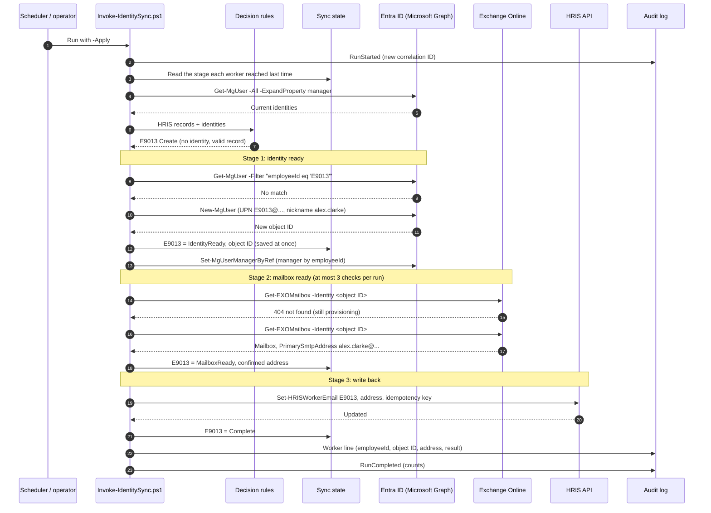

# Sequence diagram

How one new joiner goes from an HRIS record to an Entra identity, a mailbox, and
a confirmed email address written back to the HRIS, including retries within a
run and reconciliation across runs. The participants are the real services;
in this repository they are the mocks in `IdentitySync.Mocks.psm1`, with the
same command names.

## One joiner, first run



## Retries within a run

Every call above goes through `Invoke-WithRetry`. Only transient failures are
retried; the lookup and create are retried together, so each attempt looks
before creating.

```mermaid
sequenceDiagram
    autonumber
    participant Sync as Invoke-IdentitySync.ps1
    participant Retry as Invoke-WithRetry
    participant Svc as Graph / Exchange / HRIS

    Sync->>Retry: Call (for example Set-HRISWorkerEmail)
    Retry->>Svc: Attempt 1
    Svc-->>Retry: 503 Service Unavailable
    Note over Retry: Wait 2s + jitter
    Retry->>Svc: Attempt 2
    Svc-->>Retry: 429 Too Many Requests, Retry-After 5
    Note over Retry: Wait 5s (Retry-After)
    Retry->>Svc: Attempt 3
    alt Succeeds
        Svc-->>Retry: OK
        Retry-->>Sync: Result
    else Still failing after attempt 4
        Svc-->>Retry: 503
        Retry-->>Sync: Error (gave up after 4 attempts)
        Note over Sync: Stage recorded as failed;<br/>only this stage runs next time
    end
    Note over Retry,Svc: 400, 401, 404, 409 and 422 are never retried
```

## Reconciliation across runs

A worker who did not finish carries on from the stage they reached. Nothing
earlier is repeated.

```mermaid
sequenceDiagram
    autonumber
    participant Sync as Invoke-IdentitySync.ps1 (next run)
    participant State as Sync state
    participant Graph as Entra ID
    participant EXO as Exchange Online
    participant HRIS as HRIS API

    Sync->>State: Read stages
    State-->>Sync: E9012 MailboxPending, E9015 WriteBackFailed, E9013 Complete

    Note over Sync: E9013 Complete: skipped

    Note over Sync,EXO: E9012: mailbox only (identity already exists)
    Sync->>EXO: Get-EXOMailbox (up to 3 checks)
    alt Mailbox found
        EXO-->>Sync: PrimarySmtpAddress
        Sync->>HRIS: Write back
    else Still missing, less than 24 hours since identity ready
        EXO-->>Sync: 404
        Sync->>State: Still MailboxPending
    else Still missing after 24 hours
        Sync->>State: MailboxTimeout (stops; a person checks licensing)
    end

    Note over Sync,HRIS: E9015: write-back only (no create, no mailbox wait)
    Sync->>HRIS: Set-HRISWorkerEmail, same idempotency key
    alt HRIS had no address
        HRIS-->>Sync: Updated
        Sync->>State: Complete
    else HRIS already had the same address
        HRIS-->>Sync: NoChange
        Sync->>State: Complete
    else HRIS has a different address
        HRIS-->>Sync: 409 Conflict
        Sync->>State: ManualReview (never overwritten)
    end

    Note over Sync,Graph: If the state file was lost, stage 1 looks up the<br/>employeeId first, finds the existing identity and carries on
```
